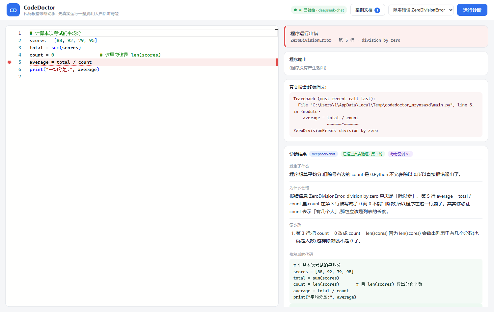
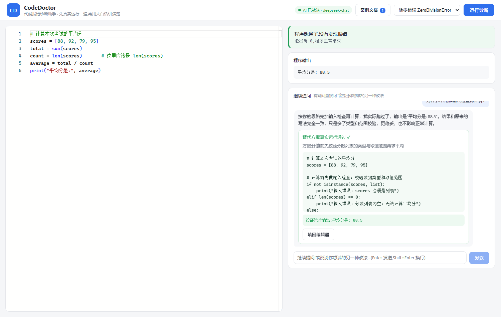
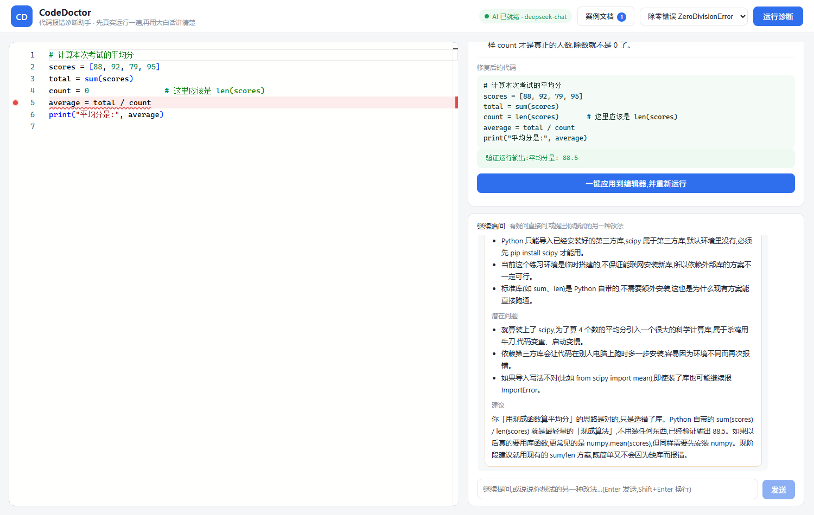

# CodeDoctor · 代码报错诊断助手

> 一个会「先把代码跑一遍」再开口的 AI 编程助教
>
> A beginner-friendly Python debugging assistant that **actually executes your code** before diagnosing it.

[](https://www.python.org/)
[](https://fastapi.tiangolo.com/)
[](https://vuejs.org/)
[](https://python.langchain.com/)
[](https://github.com/langchain-ai/langgraph)
[](LICENSE)

## 它是什么

面向编程初学者的 Python 报错诊断工具。把跑不通的代码贴进来:

1. **真的把代码跑一遍** —— 在独立临时目录里真实执行,亲眼看到报错,而不是凭空猜测;
2. **查一遍错误知识库** —— 30 条初学者常见错误的结构化条目,精确索引为主、向量语义检索兜底;
3. **参考你的案例文档** —— 上传教学资料(Markdown / txt / Word / PDF),自动切分、向量化入库,诊断时自动召回最相关的案例片段;
4. **用大白话解释** —— 发生了什么、为什么错,像助教一样讲给你听;
5. **修复先验证再交付** —— LangGraph 闭环:AI 给出的修复代码先在服务端真跑一遍,没跑通会带着新报错自动重试(最多 3 轮),通过后才交付「已通过真实验证」的修复;
6. **一键填回编辑器** —— 修复后的代码直接写回编辑区(支持 Ctrl+Z 撤销),报错行自动标红定位;
7. **能继续追问** —— 「为什么不那样改?」这类问题会被当真:按你的思路改一版、真实跑一遍再回答 —— 行得通就交付新方案,行不通就讲清楚为什么(具体原因 / 技术限制 / 潜在问题 / 建议)。

> **和常见 AI 编程助手的区别**:大多数工具在「猜」你的代码为什么报错;CodeDoctor 先在你的机器上**复现**这个错误 —— 先复现、再确诊、修复必验证。

## 界面预览

### 真实诊断:复现报错 → 大白话解释 → 修复代码通过真实验证后交付



### 多轮追问:按「先做输入检查」的思路改一版,真跑验证通过后交付



### 方案走不通时:结构化解释(具体原因 / 技术限制 / 潜在问题 / 建议)



## 架构

```
前端 (Vite + Vue 3 + Monaco Editor)
        │  HTTP /api/run、/api/diagnose(/stream)、/api/chat/stream
        ▼
后端 (FastAPI)
  ├── runner.py               真实执行引擎:subprocess + 超时终止 + 输出截断
  ├── traceback_parser.py     解析 traceback:错误类型 / 报错行号 / 该行代码
  ├── kb.py                   知识库分层检索:L1 精确索引(主力)+ L2 向量兜底
  ├── knowledge/errors.json   语料:30 条常见错误(一份知识,两条路径共用)
  ├── rag.py                  案例文档库:加载→切分→向量化→入库→检索(独立 Chroma 集合)
  ├── llm.py                  LangChain 结构化输出(Pydantic schema + 自动降级)
  ├── graph.py                LangGraph 诊断-修复-验证闭环(≤ CD_MAX_FIX_ROUNDS 轮)
  ├── chat.py                 多轮追问:会话上下文 + 意图识别 + 替代方案真跑/结构化解释
  └── main.py                 API 入口
        │
        ▼
对话模型:云端 OpenAI 兼容服务(默认 DeepSeek)或本地 Ollama
嵌入模型:硅基流动 BAAI/bge-m3(云端,免费)或本地 Ollama bge-m3(向量:Chroma 持久化)
```

## 快速开始

需要 Python 3.10+ 与 Node.js 18+。

### 0. 获取 API Key(推荐:全云端,零本地资源占用)

| 用途 | 获取地址 | 填入配置项 |
| --- | --- | --- |
| 对话模型 | [DeepSeek 开放平台](https://platform.deepseek.com) | `CD_API_KEY` |
| 嵌入模型(免费) | [硅基流动](https://cloud.siliconflow.cn)(API 密钥页面) | `CD_EMBED_API_KEY` |

> 嵌入模型用硅基流动的 `BAAI/bge-m3`(**免费**;注意免费版模型 ID 就是 `BAAI/bge-m3`,不要写 `Pro/` 前缀)。
> 想离线/零成本运行?对话与嵌入都可切回本地 Ollama,见「可选:本地 Ollama 模式」。
> 不填任何 Key 也能用 —— 会自动进入知识库规则模式。

### 1. 启动后端

```bash
cd backend

# 安装依赖
pip install -r requirements.txt

# 配置(复制模板后填写)
cp .env.example .env        # Windows: copy .env.example .env

# 启动服务(端口 8000)
python -m uvicorn main:app --host 127.0.0.1 --port 8000
```

### 2. 启动前端

```bash
cd frontend
npm install
npm run dev
```

打开浏览器访问 **http://127.0.0.1:5173** 即可使用。

## 核心机制

### 诊断 - 修复 - 验证闭环

```
用户报错 → [知识库检索] → [AI 结构化诊断] → [真跑验证修复代码]
                                                    │
              通过 ─────────────────────────────────┤
                                                    │ 没跑通且未超轮数
              交付「已通过真实验证」                   ▼
                                       带着新报错回到诊断(≤3 轮)
```

- 修复代码必须通过真实运行才算数;没跑通会带着**新报错**回到诊断重试(最多 `CD_MAX_FIX_ROUNDS` 轮,默认 3)。
- 多轮不是重复:重试时会把「上一轮修复代码 + 它跑出的真实报错」一起喂回模型,逐层剥开叠加的错误。
- 3 轮仍不通过:如实标注「未通过验证」并给出每轮失败轨迹(`attempts`),不假装成功。
- 响应字段:`verified`(是否真实验证通过)、`verify_rounds`(实际轮数)、`verify_output`(验证运行输出)、`attempts`(每轮成败记录)、`knowledge_ids`(命中的知识条目)、`case_sources`(命中的案例片段)。

### 流式诊断(实时输出)

网页端诊断全程「边生成边展示」,不用干等转圈。数据链路:`POST /api/diagnose/stream` 以 SSE(`text/event-stream`)实时推送下列事件 ——

| 事件 | 内容 |
| --- | --- |
| `status` | 阶段变化:检索知识库/案例库 → AI 分析(第 N 轮) → 真实运行验证(第 N 轮) → 验证结果 |
| `field` / `delta` | 诊断文本逐字增量:`explain` / `reason` / `fixed_code` |
| `item` | `fix_points` 数组的单条完成事件 |
| `result` | 最终完整诊断数据(与 `/api/diagnose` 结构一致);`error` / `done` 收尾 |

- **增量 JSON 抽取**:模型输出的是结构化 JSON(字面直接吐给用户没法看),`backend/stream_json.py` 用逐字符状态机在 JSON 尚未生成完时实时抽出人话字段,正确处理转义 / unicode / 代理对 / 任意 token 切分边界;解析不动时自动降级回完整解析。
- **LangGraph 不动**:事件经 contextvar 从图节点里推出来,验证失败重试时前端会显示「第 N 轮:验证未通过」轨迹并清空旧内容重写新诊断。
- **降级链**:流式 + JSON 强制 → 流式纯提示词 → 非流式 `diagnose()`。最终结果永远完整可用。
- 非流式口味仍然保留:`POST /api/diagnose`(一次性返回)。

### 多轮追问(继续对话)

诊断完成后 —— 或者你把代码改好 / 一键应用修复、运行通过之后 —— 网页诊断面板下方都会出现「继续追问」对话区,和 CodeDoctor 接着聊,它记得全部上下文(跑通场景会带上「上一轮诊断」背景,问「为什么这样改就好了」也答得上)。

**两类消息,自动区分**(意图由 LLM 分类,失败时关键词兜底):

1. **普通提问** → 结合完整上下文(代码 / 真实报错 / 诊断结果 / 全部历史对话)流式自然回答;
2. **提出替代思路** → 「为什么不那样改?」「为什么不用那个方案?」「能不能用 X?」「换成 Y 试试」这类指向性表述会被自动识别为「另一套修改方案」,进入**方案重执行流程**:
   - 按用户思路生成完整代码 → **真实运行**(与主诊断同一执行引擎,同一套安全护栏);
   - 没跑通会带着真实报错自动重试(≤ `CD_CHAT_ALT_ROUNDS` 轮,且**不会偷偷替换用户点名的库**);
   - **通过** → 交付新方案(代码 + 真实运行输出 + 一键填回编辑器),并把它更新为当前采纳方案;
   - **走不通 / 无法实现** → 结构化解析:**具体原因**(引用真实报错证据)/ **技术限制** / **潜在问题** / **建议**。典型场景:用户点名的库在当前环境未安装(真实 `ModuleNotFoundError`)→ 如实报告不可执行,绝不"换个库假装成功"。

会话保存在服务端内存,完整记录代码 / 报错 / 诊断 / 方案尝试 / 全部对话消息;每条消息都携带完整历史送进模型。后端重启后,前端把保留的历史随下一条消息带上,自动恢复对话链。

### 知识库

- 语料在 `backend/knowledge/errors.json`,字段:`error_type` / `message_patterns`(正则)/ `title` / `scenarios` / `explain` / `fix_points` / `example_bad` / `example_good`。
- **L1 精确索引(主力)**:错误类型 + 报错消息正则,命中即确定;**L2 向量检索(兜底)**:bge-m3 + Chroma,仅当 L1 未命中时启用(防止「语义相似但错误不同」的污染)。
- 语料内容变化后,向量索引按「语料哈希 + 后端指纹」自动重建(无需手动操作;切换嵌入后端时同样自动重建,防止两种后端向量混用)。
- 一份知识两条路径:AI 模式下作为「参考知识」注入 prompt;未配置 Key 时直接用条目模板兜底。
- **扩展知识库**:往 `errors.json` 加条目 → 运行 `python check_kb.py` 自查(提前发现 JSON 语法 / 字段缺失 / 非法正则)→ 重启后端生效。

### 案例文档库(RAG)

不想改 `errors.json`?直接把案例文档「喂」给 CodeDoctor —— 网页顶栏点「案例文档」拖拽上传即可:

- **支持格式**:Markdown(md)/ txt / Word(docx)/ PDF,单个文件 ≤ 10MB;
- **自动管道**(全部基于 LangChain 标准组件):`TextLoader` / `Docx2txtLoader` / `PyPDFLoader` 加载 → `MarkdownHeaderTextSplitter` 按标题切分 + `RecursiveCharacterTextSplitter` 超长细分(前置代码块保护,代码块不会被劈开、注释里的 `#` 不会被误判为标题)→ 向量化 → 存入独立的 Chroma 集合;
- **诊断时自动参考**:每次诊断把报错语义与案例库做向量检索(默认召回 top-2),命中片段作为「参考案例」注入 AI 提示词;前端诊断卡会显示「参考案例 ×N」标签;
- **独立分区**:案例库(`codedoctor_cases`)与结构化知识库(`codedoctor_kb`)互不影响,文档可随时上传/删除;
- **原文留档**:上传的文档原文保存在 `knowledge/uploads/`,换嵌入后端时自动重建索引,无需重传;
- **接口方式**:`POST /api/kb/upload`(multipart 上传)、`GET /api/kb/docs`(列表)、`DELETE /api/kb/docs/{doc_id}`(删除)。

## 配置说明(backend/.env)

| 变量 | 说明 | 默认值 |
| --- | --- | --- |
| `CD_API_KEY` | 对话模型 API Key;**留空时进入知识库规则模式** | 空 |
| `CD_BASE_URL` | OpenAI 兼容接口地址 | `https://api.deepseek.com` |
| `CD_MODEL` | 对话模型名 | `deepseek-chat` |
| `CD_PORT` | 后端端口 | `8000` |
| `CD_EXEC_TIMEOUT` | 代码执行超时(秒),防死循环 | `10` |
| `CD_EMBED_PROVIDER` | 嵌入后端:`ollama`(本地)/ `siliconflow`(硅基流动云端,免费) | `ollama` |
| `CD_EMBED_API_KEY` | 硅基流动 API Key(选 `siliconflow` 时必填;缺失时自动回退本地) | 空 |
| `CD_EMBED_BASE_URL` | 硅基流动 OpenAI 兼容地址 | `https://api.siliconflow.cn/v1` |
| `CD_EMBED_MODEL` | 嵌入模型名;留空按实际生效的后端自动选(ollama→`bge-m3` / siliconflow→`BAAI/bge-m3`) | 空 |
| `CD_OLLAMA_BASE` | 本地 Ollama 地址(选 `ollama` 时使用) | `http://127.0.0.1:11434` |
| `CD_KB_TOP_K` | 知识库检索注入条数上限 | `3` |
| `CD_KB_VECTOR` | 置 `0` 关闭向量检索(纯精确索引) | `1` |
| `CD_KB_MAX_DISTANCE` | 向量距离上限,超出丢弃 | `0.45` |
| `CD_CASE_TOP_K` | 每次诊断从案例库召回的片段数 | `2` |
| `CD_CASE_MAX_DISTANCE` | 案例检索距离上限(案例文本更杂,略放宽) | `0.55` |
| `CD_MAX_FIX_ROUNDS` | 修复代码最多验证轮数 | `3` |
| `CD_CHAT_ALT_ROUNDS` | 追问中「替代方案」的真实验证重试轮数 | `2` |
| `CD_STRUCTURED_METHOD` | 云端接口结构化输出方式:function_calling / json_schema / json_mode | `function_calling` |

## 可选:本地 Ollama 模式(零成本、离线可用)

对话模型与嵌入模型可**独立切换**(自由组合「云端对话 + 本地嵌入」或反之):

**对话模型切本地** —— 启动时用环境变量覆盖(优先级高于 `.env`):

```powershell
$env:CD_API_KEY = 'ollama'
$env:CD_BASE_URL = 'http://127.0.0.1:11434/v1'
$env:CD_MODEL = 'qwen2.5:7b'
python -m uvicorn main:app --host 127.0.0.1 --port 8000
```

**嵌入模型切本地** —— `.env` 中改 `CD_EMBED_PROVIDER=ollama`(需先 `ollama pull bge-m3`)。

> 当前生效的后端可通过 `/api/health` 的 `kb_backend` 字段随时查看。

## API

| 方法 | 路径 | 说明 |
| --- | --- | --- |
| GET | `/api/health` | 健康检查:AI 配置、知识库条数、案例库状态、超时/轮数配置 |
| POST | `/api/run` | 真实执行代码,返回 stdout / stderr / 报错解析(类型、行号、代码片段) |
| POST | `/api/diagnose` | 诊断-验证闭环:检索知识库 + 案例库 → AI 诊断 → 修复代码真跑验证(含重试) |
| POST | `/api/diagnose/stream` | 流式诊断(SSE):实时推送 检索/分析/逐字文本/验证进度 事件,最后给完整结果(前端主用) |
| POST | `/api/chat/stream` | 多轮追问(SSE):普通问答流式回答;替代方案(「为什么不那样改」)真实验证 + 结构化解释 |
| POST | `/api/kb/upload` | 上传案例文档(multipart),自动切分、向量化、入库 |
| GET | `/api/kb/docs` | 已入库案例文档列表(文件名 / 知识块数 / 上传时间) |
| DELETE | `/api/kb/docs/{doc_id}` | 删除一份案例文档(向量 + 原文留档) |

## 安全护栏

- 每段代码在**独立临时目录**中执行,运行结束自动清理;
- **stdin 关闭**:程序等待输入时直接报错,不会挂起;
- **超时终止**:超过 `CD_EXEC_TIMEOUT` 秒强制结束(防死循环);
- **输出截断**:单次运行输出上限 20000 字符;
- AI 调用失败/输出异常时自动降级为知识库规则模式,核心链路始终可用。

## 项目结构

```
codedoctor/
├── backend/
│   ├── main.py                  FastAPI 入口
│   ├── runner.py                代码执行引擎(核心)
│   ├── traceback_parser.py      traceback 解析
│   ├── kb.py                    知识库分层检索 + 规则兜底
│   ├── knowledge/
│   │   ├── errors.json          语料(30 条,覆盖 18 类错误)
│   │   └── uploads/             上传的案例文档原文(运行时生成)
│   ├── rag.py                   案例文档库(RAG):加载/切分/入库/检索
│   ├── llm.py                   LangChain 结构化输出 + prompt
│   ├── graph.py                 LangGraph 诊断-验证闭环
│   ├── stream_json.py           流式 JSON 增量解析(打字机效果核心)
│   ├── chat.py                  多轮追问:会话 + 意图识别 + 替代方案执行
│   ├── doctor.py                诊断编排入口
│   ├── config.py                配置加载
│   ├── check_kb.py              知识库校验工具
│   ├── requirements.txt         Python 依赖
│   └── .env.example             配置模板(复制为 .env 使用)
├── frontend/
│   ├── src/
│   │   ├── App.vue              主界面(编辑器 + 诊断面板 + 追问对话区)
│   │   ├── components/MonacoEditor.vue    Monaco 封装(标红/填回)
│   │   ├── api.js               接口调用(含 SSE 流式客户端)
│   │   └── styles.css           全局样式
│   ├── vite.config.js           dev server + /api 代理
│   └── package.json
├── docs/                        界面截图
├── tmp/                         端到端验证脚本(HTTP 接口 + 浏览器 CDP)
├── LICENSE
└── README.md
```

## License

本项目基于 [MIT License](LICENSE) 开源 —— 可自由使用、修改、分发与商用,保留版权声明即可。
